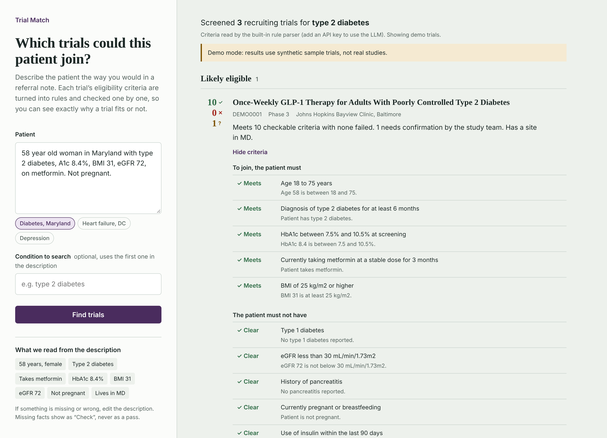
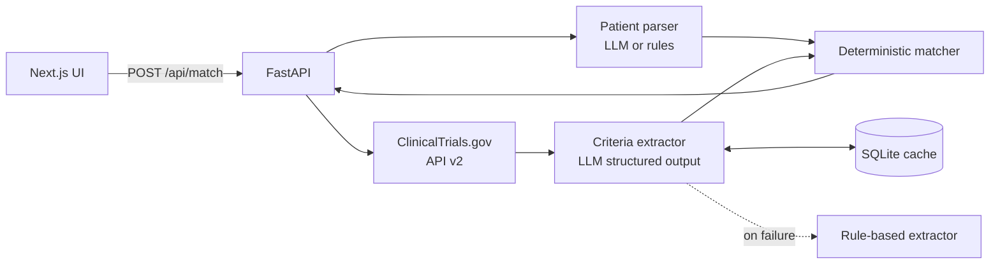

# AI Clinical Trial Matcher

**Describe a patient in plain English. See which recruiting clinical trials they could join, with every eligibility criterion checked and explained.**

**[Try the live demo](https://jeetparekh16.github.io/ai-clinical-trial-matcher/)**: no sign up, runs entirely in your browser.



Finding trials is slow because eligibility criteria are free text: *"HbA1c between 7.5% and 10.5%"*, *"no insulin within 90 days"*, *"ECOG 0–1"*. Research coordinators read them one trial at a time. This app uses an LLM to turn that text into structured rules once per trial, then checks a patient against the rules with plain, deterministic code, so every verdict is explainable.

[](../../actions/workflows/ci.yml)


## What it does

1. **Reads the patient.** *"58 year old woman in Maryland with type 2 diabetes, A1c 8.4%, BMI 31, eGFR 72, on metformin"* becomes structured data: age, sex, conditions, medications, labs, location. The app shows what it understood so the user can correct it.
2. **Finds recruiting trials** for the condition through the [ClinicalTrials.gov API v2](https://clinicaltrials.gov/data-api/api).
3. **Turns each trial's criteria into rules.** The LLM extracts `{"field": "hba1c", "operator": "between", "value": 7.5, "value_max": 10.5}` and similar, using structured output (tool use with a JSON schema), so responses are always valid.
4. **Checks every rule** against the patient: *Meets*, *Fails*, or *Check* when information is missing. Exclusions read as *Clear* or *Excluded*.
5. **Ranks trials** into *Likely*, *Possibly* and *Not eligible*, boosts trials with a site in the patient's state, and explains each result in a sentence.

## Design decisions

**The LLM reads; code decides.** The LLM only converts text into rules. Whether a patient meets a rule is decided by plain Python, so the model cannot hallucinate eligibility, every verdict cites the rule and the patient fact behind it, and results are repeatable.

**Missing information is never a pass.** If the description has no eGFR, an eGFR criterion shows *Check*, not *Meets*. Criteria a program cannot judge (consent, investigator opinion) are flagged for human review rather than guessed.

**Pay for extraction once.** Extracted rules are cached in SQLite by a hash of the criteria text, so each trial costs one LLM call no matter how many patients are screened against it.

**Works without an API key.** A rule-based extractor (regular expressions plus a curated medical vocabulary) runs offline. It is the fallback if the LLM call fails, and the baseline the LLM is measured against.

## Architecture



| Path | What it does |
|---|---|
| `backend/trialmatch/criteria_llm.py` | LLM extractor: forced tool call whose input schema is the `Criterion` model; output normalised to a shared vocabulary |
| `backend/trialmatch/criteria_rules.py` | Offline extractor: section and bullet splitting, threshold parsing (`≥ 7.5`, `between 7 and 10`, `18 years or older`) |
| `backend/trialmatch/matcher.py` | Evaluates rules, inverts exclusions, tiers and ranks trials, writes explanations |
| `backend/trialmatch/extractor.py` | Chooses the extractor, caches results, falls back to rules on any LLM error |
| `backend/trialmatch/ctgov.py` | ClinicalTrials.gov client and parser; bundled synthetic demo trials |
| `backend/eval/` | Labeled criteria and the evaluation script |
| `frontend/` | Next.js 16 (App Router, TypeScript) screening interface |

## Measuring extraction quality

A matcher is only as good as its rules, so extraction is evaluated against hand-labeled criteria (`backend/eval/`). The metric that matters most is the **unsafe rate**: how often the extractor produces a checkable rule that is wrong, since a wrong rule can wrongly exclude a patient. An unstructured "please review" is safe; a wrong threshold is not.

| Extractor | Data | Exact match | Recall on checkable criteria | Unsafe rate |
|---|---|---|---|---|
| Rules (offline) | Held-out set, 40 criteria | 88% | 85% | 2% |
| LLM | Held-out set, 40 criteria | run it with your key | | |

The rules were written alongside a separate 52-item development set (`dev_set.jsonl`), where they score 100%; that set is a regression test, not a measure of accuracy. The held-out set was written afterwards in different phrasing and was not used for tuning. Its misses are in [`eval/results_rules_heldout.md`](backend/eval/results_rules_heldout.md): mostly unusual age phrasing ("eighteen (18) years of age") and indirect medication wording ("requires ongoing anticoagulation"), which is where the LLM extractor is expected to help.

```bash
cd backend
python eval/run_eval.py                                   # rules, held-out set
ANTHROPIC_API_KEY=sk-... python eval/run_eval.py --extractor llm
```

## Run it

**Requirements:** Python 3.11+, Node 22+. An Anthropic API key is optional.

```bash
# Terminal 1: API on :8000
cd backend
python -m venv .venv && source .venv/bin/activate
pip install -e ".[dev]"
export ANTHROPIC_API_KEY=sk-...        # optional: use the LLM instead of the rule parser
export TRIAL_DATA_SOURCE=live          # or "sample" for the offline demo trials
uvicorn trialmatch.api:app --port 8000

# Terminal 2: UI on :3000
cd frontend
npm install && npm run dev
```

Open http://localhost:3000 and pick an example patient.

**Static demo (GitHub Pages):** `scripts/build_pages.sh` packages the Python matcher and builds a static site where it runs in the browser with [Pyodide](https://pyodide.org) (Python compiled to WebAssembly). The same `trialmatch` package powers the API and the demo, and the browser fetches trials from ClinicalTrials.gov directly, falling back to the demo trials if that fails. The `Deploy demo` workflow publishes it on every push to `main`.

**Docker:** `cp .env.example .env`, then `docker compose up --build`.

**API only:**

```bash
curl -s localhost:8000/api/match -H 'Content-Type: application/json' -d '{
  "patient_description": "67 year old man in Texas with heart failure, LVEF 35%, eGFR 48",
  "limit": 5
}'
```

Interactive API docs: http://localhost:8000/docs

## Tests

```bash
cd backend && pytest && ruff check .     # 55 tests: extractors, parser, matcher, engine, API, ClinicalTrials.gov client
cd frontend && npm test && npm run typecheck && npm run build
```

The LLM paths are tested with a fake Anthropic client (structured output, normalisation, caching, and fallback when the API fails). The ClinicalTrials.gov client is tested against a mocked HTTP transport with the real API's response shape. If ClinicalTrials.gov cannot be reached, the API falls back to the bundled demo trials and says so in the response.

## Limitations

- **A screening aid, not a medical decision.** Final eligibility is always confirmed by the study team.
- The demo trials (IDs starting `DEMO`) are synthetic and written for this project; they are not real studies.
- The medical vocabulary is small and hand-curated. A production version would map terms to UMLS, SNOMED CT and RxNorm.
- Free-text patient descriptions lose nuance. A production version would read structured data from an EHR over FHIR.
- Never enter real patient identifiers into a deployment that is not HIPAA-compliant.

## Roadmap

- SMART on FHIR launch to read the patient from an EHR instead of free text
- Distance-based site ranking using the API's geo coordinates
- LLM-written plain-language trial summaries for patients
- LLM eval results across models (cost, latency, accuracy) published in the repo

## License

MIT. Built by [Jeet Parekh](https://www.linkedin.com/in/jeetparekh16).
